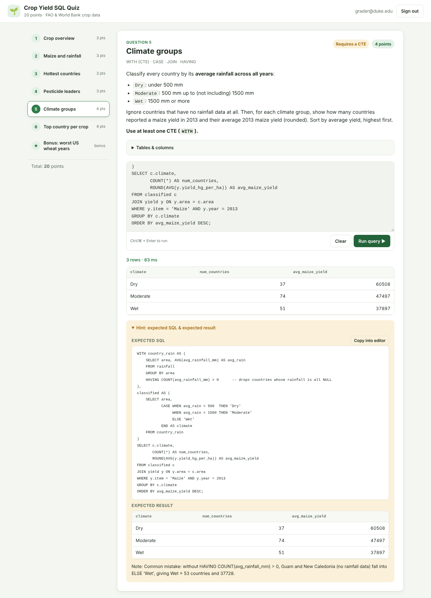
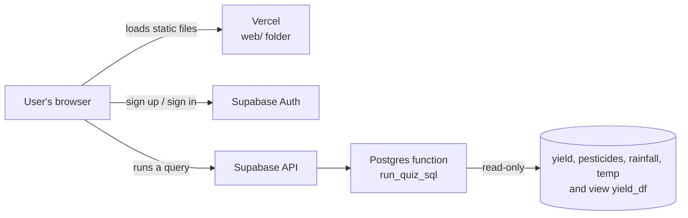
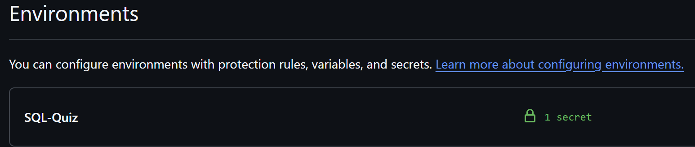

# IDS706 SQL Quiz: Crop Yields

**Live quiz site: https://ids706-sqlquiz-web.vercel.app/**

A 20-point SQL quiz about global crop yields. A signed-in user picks a question, writes SQL in the browser, runs it against a real PostgreSQL database hosted on Supabase, and sees the result table. Every question has a hint showing the expected SQL and the expected result, so a grader can run a query and compare it to the hint.



---

## Contents
1. [How to use the quiz](#how-to-use-the-quiz)
2. [The questions](#the-questions)
3. [The data](#the-data)
4. [How the system is set up](#how-the-system-is-set-up)
5. [Repository layout](#repository-layout)
6. [Rebuilding it from scratch](#rebuilding-it-from-scratch)
7. [Secrets](#secrets)
8. [Earlier PostgreSQL demo files](#earlier-postgresql-demo-files)

---

## How to use the quiz

1. Open **https://ids706-sqlquiz-web.vercel.app/**.
2. **Create an account** (tab on the sign-in card) with any email and a password of at least 6 characters, then **Sign in**.
   If the site says a confirmation email was sent, click the link in that email first, then sign in.
3. Pick a question from the list on the left (on a phone, the list scrolls sideways across the top).
4. Write a query in the editor and click **Run query ▶** (or press **Ctrl + Enter** / **⌘ + Enter**).
   The result table appears under the editor, with the row count.
5. Open **Hint: expected SQL & expected result** to see the answer key. **Copy into editor** puts the expected SQL in the editor so it can be run directly.
6. **Tables & columns** (above the editor) lists every table and column.

**Grading:** open a question, run SQL, and compare the result table to the expected result in the hint. Values are shown exactly as the database returns them (no thousands separators), so they match the hint character for character.

**Rules enforced by the database**
- Only `SELECT` or `WITH ... SELECT` queries; one statement per run (a trailing `;` is fine).
- No changes to data are possible (no `INSERT`, `UPDATE`, `DELETE`, `DROP`, ...).
- At most 1,000 rows are displayed, and a query is stopped after 8 seconds.
- `--` comments are allowed.

What you type is saved in your browser, per question, so you can switch questions without losing work.

---

## The questions

SQL used across the quiz: `SELECT`, `FROM`, `WHERE`, `JOIN ... ON`, `GROUP BY`, `HAVING`, `ORDER BY`, `LIMIT`, `COUNT`, `SUM`, `AVG`, `ROUND`, `CASE WHEN ... THEN ... ELSE ... END`, `WITH` (CTE), `RANK() OVER (PARTITION BY ...)`, `LAG`.

| # | Question | Points | Main concepts |
|---|---|---|---|
| 1 | Crop overview: records and average yield per crop | 3 | `COUNT`, `AVG`, `ROUND`, `GROUP BY`, `ORDER BY` |
| 2 | Top 5 maize yields in 2013, with that year's rainfall | 3 | `JOIN`, `WHERE`, `ORDER BY`, `LIMIT` |
| 3 | Countries averaging above 28 °C (1990–2013) | 3 | `WHERE`, `GROUP BY`, `HAVING` |
| 4 | Top 3 pesticide users and their potato yield | 3 | `JOIN`, `SUM`, `AVG`, `LIMIT` |
| 5 | Maize yield by climate group (Dry / Moderate / Wet) | 4 | **`WITH` (CTE, required)**, `CASE`, `HAVING` |
| 6 | Highest-yielding country for each crop in 2016 | 4 | `RANK() OVER (PARTITION BY ...)`, `WITH` |
| ★ | Bonus (not graded): worst year-over-year drops in US wheat yield | 0 | `LAG() OVER`, `WITH` |
| | **Total** | **20** | |

The full question text, expected SQL and expected results are in [`datasets/quiz_questions.md`](datasets/quiz_questions.md) and in [`web/questions.js`](web/questions.js) (the file the site reads). All expected results were checked by running the hint SQL against the live database.

---

## The data

**Source:** [Crop Yield Prediction Dataset](https://www.kaggle.com/datasets/patelris/crop-yield-prediction-dataset) on Kaggle (by patelris), compiled from the UN Food and Agriculture Organization (FAO) and the World Bank. It covers the 10 most consumed crops worldwide.

### Tables in the database

| Table | Columns | Rows | Notes |
|---|---|---|---|
| `yield` | `area_code`, `area`, `item_code`, `item`, `year`, `yield_hg_per_ha` | 56,717 | Yield per country (`area`), crop (`item`) and year, 1961–2016, in hectograms per hectare. Key: (`area`, `item`, `year`). |
| `pesticides` | `area`, `year`, `pesticides_tonnes` | 4,349 | Total pesticide use, tonnes of active ingredients, 1990–2016. Key: (`area`, `year`). |
| `rainfall` | `area`, `year`, `avg_rainfall_mm` | 6,727 | Average annual rainfall, 1985–2017. 780 values are `NULL` (not reported). Key: (`area`, `year`). |
| `temp` | `area`, `year`, `avg_temp_c` | 27,479 | Average annual temperature in °C, 1743–2013. Key: (`area`, `year`). |
| `yield_df` | `area`, `item`, `year`, `yield_hg_per_ha`, `avg_rainfall_mm`, `pesticides_tonnes`, `avg_temp_c` | 15,610 | **View** joining the four tables, 1990–2013. Not needed for any question. |

**How the tables relate:** every table has `area` (country, FAO spelling) and `year`, so they join on `area` and `year`. Crops are the 10 values of `yield.item`: Cassava, Maize, Plantains and others, Potatoes, Rice paddy (`'Rice, paddy'`), Sorghum, Soybeans, Sweet potatoes, Wheat, Yams.

**Data quirks worth knowing:** some `area` values are regions or former countries (e.g. `China`, `China, mainland`, `USSR`); the US is `'United States of America'`.

### How the raw Kaggle files were cleaned
Raw files are in `datasets/`; cleaned files (the ones loaded into Supabase) are in `datasets/cleaned/`.

1. **Country names harmonised.** `rainfall` and `temp` used different names than `yield`/`pesticides` (e.g. "United States" vs "United States of America", "Russia" vs "Russian Federation", "Vietnam" vs "Viet Nam"). About 30 names were mapped to the FAO spelling so joins don't silently drop countries. Remaining unmatched names are small territories with no crop data.
2. **Rainfall:** stray whitespace removed from country names; the placeholder `..` and blanks became `NULL`.
3. **Temperature:** the raw file had one row per weather station, so many countries had several rows per year. These were averaged to one row per country per year (rounded to 2 decimals), and rows with no temperature were dropped.
4. **Constant columns dropped:** columns that held the same value on every row (e.g. `domain`, `element`, `unit`) were removed, and value columns were renamed (`value` → `yield_hg_per_ha`, `pesticides_tonnes`).
5. **`yield_df` rebuilt as a view.** In the original Kaggle `yield_df.csv`, over half the rows are duplicates caused by the weather-station rows. The database version is a view built from the cleaned tables instead. `datasets/cleaned/yield_df.csv` is kept only for reference and is not loaded.

---

## How the system is set up



**Website (Vercel).** `web/` is a static site: plain HTML, CSS and JavaScript, with no build step. Vercel deploys it from this GitHub repo with **Root Directory = `web`**, and redeploys automatically on every push to `main`. The page loads the Supabase JavaScript client (`@supabase/supabase-js` v2) from a CDN.

**Sign-in (Supabase Auth).** Email and password accounts. The site only shows the quiz to signed-in users, and only signed-in users can run SQL.

**Running SQL (Supabase Postgres).** The browser never connects to the database directly. It calls one Postgres function, `public.run_quiz_sql(query text)`, through Supabase's API. The function ([`supabase/run_quiz_sql.sql`](supabase/run_quiz_sql.sql)):
- can only be called by signed-in users (the `authenticated` role); anonymous visitors are refused;
- accepts a single `SELECT` or `WITH` statement and rejects anything else;
- runs the query wrapped as a subquery, which also blocks data-changing statements hidden inside a `WITH`;
- runs with the caller's own permissions (`SECURITY INVOKER`), so the tables' row level security still applies: read-only;
- returns at most 1,001 rows as JSON (the site shows 1,000 and says when there were more); Supabase stops queries from signed-in users after 8 seconds.

**Database security.** Row level security (RLS) is on for all four tables, with a single "public read" policy each. Anyone can read the data; nobody can insert, update or delete through the API.

**Configuration.** [`web/config.js`](web/config.js) holds the Supabase project URL and the **anon** (public) API key. The anon key is designed to be public and only allows what RLS and the function grants allow. The `service_role` key and the database password are never in the repo.

---

## Repository layout

```
├── web/                     Quiz website (deployed by Vercel)
│   ├── index.html           Page structure (sign-in card, question list, editor, results, hint)
│   ├── app.js               Sign-in, navigation, running SQL, rendering result tables
│   ├── questions.js         Questions, points, hint SQL and expected results
│   ├── config.js            Supabase URL + public anon key
│   └── styles.css           Styling (light and dark mode, phone layout)
├── supabase/
│   └── run_quiz_sql.sql     The read-only SQL runner function the site calls
├── datasets/
│   ├── *.csv                Raw Kaggle files
│   ├── quiz_questions.md    Quiz questions with expected SQL and results
│   └── cleaned/
│       ├── schema.sql       Database schema (tables, view, RLS policies)
│       └── *.csv            Cleaned data loaded into Supabase
├── docs/quiz-screenshot.png Screenshot used in this README
├── init.sql, query.py,      Earlier PostgreSQL demo (see below)
│   requirements.txt
└── psst.png                 Screenshot of the GitHub environment holding the secret
```

---

## Rebuilding it from scratch

1. **Supabase project.** Create a project at [supabase.com](https://supabase.com).
2. **Schema.** In **SQL Editor**, run [`datasets/cleaned/schema.sql`](datasets/cleaned/schema.sql).
3. **Data.** In **Table Editor**, open each table → **Insert → Import data from CSV**, and upload the matching file from `datasets/cleaned/`: `yield.csv`, `pesticides.csv`, `rainfall.csv`, `temp.csv`. Do not import `yield_df.csv`.
   Check the row counts: 56,717 / 4,349 / 6,727 / 27,479, and `select count(*) from yield_df` → 15,610.
4. **SQL runner.** In **SQL Editor**, run [`supabase/run_quiz_sql.sql`](supabase/run_quiz_sql.sql).
5. **Site config.** Put your project URL and anon key (Project Settings → API) in [`web/config.js`](web/config.js).
6. **Deploy on Vercel.** **Add New → Project → Import** this GitHub repo; set **Root Directory** to `web`, Framework Preset **Other**, leave the Build Command empty, then **Deploy**.
7. **Auth settings (Supabase → Authentication).**
   - **URL Configuration:** set **Site URL** to the Vercel address (here `https://ids706-sqlquiz-web.vercel.app`) and add `https://ids706-sqlquiz-web.vercel.app/**` under **Redirect URLs**, so confirmation emails link back to the site.
   - **Sign In / Providers → Email:** with **Confirm email** on, new users must click an emailed link before signing in, and Supabase's built-in email sender only sends a few emails per hour. Turn it off for easy grading, or create accounts under **Users → Add user** with **Auto Confirm User** ticked.
8. **Test.** Sign in on the site, open Question 1, click **Copy into editor**, and run it: you should get 10 rows starting with `Potatoes | 7876 | 150083`.

**Previewing the site locally:** from the `web/` folder run `python -m http.server 8000` and open http://localhost:8000. It talks to the same Supabase project.

---

## Secrets

- The **database password** is stored as a secret in the GitHub environment **`SQL-Quiz`** (screenshot: [`psst.png`](psst.png)) and, for local scripts, in a `.env` file that is listed in `.gitignore` and never committed.
- The website does not need the password: it only uses the public anon key in `web/config.js`.



---

## Earlier PostgreSQL demo files

`init.sql`, `query.py` and `requirements.txt` come from the class PostgreSQL demo that came before the quiz. `init.sql` creates a small `restaurants` table, and `query.py` connects with `psycopg2`, using the connection details in `.env`, to read and insert rows. They are not used by the quiz site; the `restaurants` table has since been removed from the Supabase project.

To run the demo against a database that has the `restaurants` table:
```bash
pip install -r requirements.txt
python query.py
```
`.env` needs `POSTGRES_DB`, `POSTGRES_USER`, `POSTGRES_PASSWORD`, `DB_HOST`, `DB_PORT` and, for Supabase, `DB_SSLMODE=require`.
